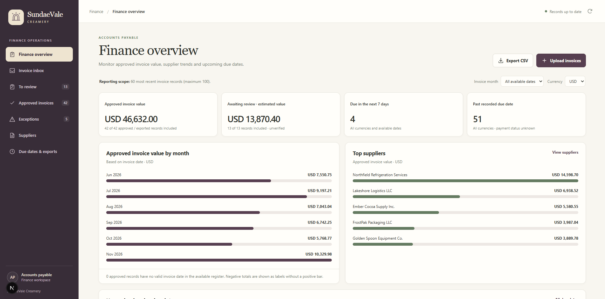
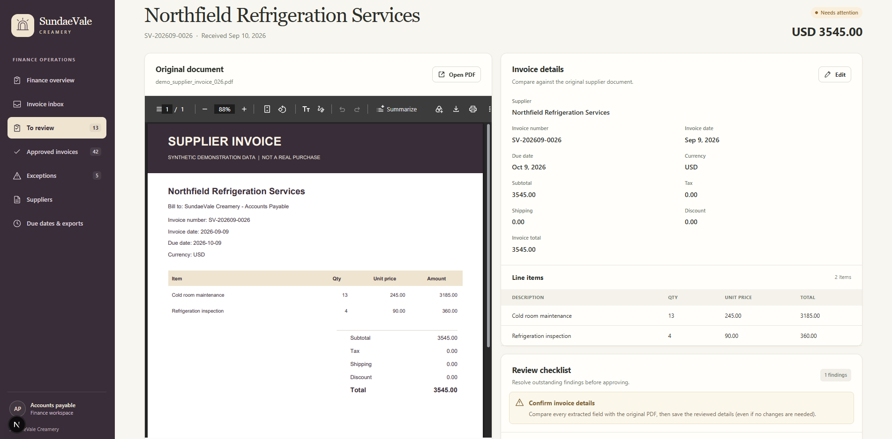
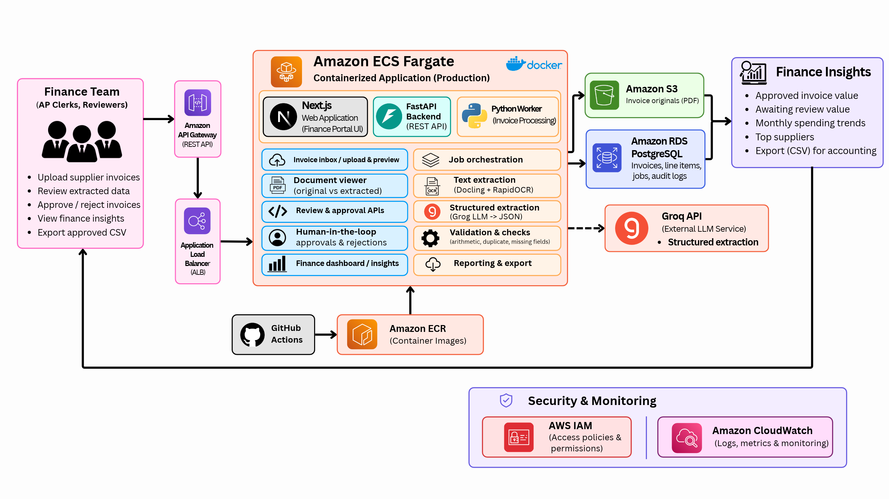

<div align="center">

# SundaeVale Creamery

### Intelligent Accounts Payable & Financial Insights Platform

**Document AI · Human-verified approvals · Supplier analytics · Docker & AWS**

A full-stack finance operations platform that converts supplier PDF invoices into validated, reviewable financial records, then turns approved data into supplier insights, due-date views, and accounting-ready CSV exports.


**[Experience](#product-experience) · [Features](#what-it-does) · [Architecture](#system-architecture) · [Quickstart](#how-to-run-the-code) · [Demo](#end-to-end-demonstration) · [Evaluation](#evaluation--verification) · [Repository](#repository-structure)**

</div>

## The problem

SundaeVale Creamery's accounts payable team receives invoices for dairy, fruit ingredients, packaging, refrigeration, equipment, and logistics. Manual entry makes it difficult to verify totals, catch duplicates, track upcoming due dates, and understand supplier costs. **SundaeVale unifies document processing, financial checks, employee review, and reporting in one workflow.**

## Product experience

**Finance overview** — Approved invoice value, review workload, monthly trends, top suppliers, and recorded due dates.



**Invoice review workspace** — Original PDF alongside extracted fields, line items, validation findings, and approval controls.



## What it does

| Invoice processing & controls | Finance operations & insights |
| --- | --- |
| Batch PDF upload and background processing | Finance overview and monthly invoice trends |
| Digital PDF parsing and scanned-document OCR | Supplier expenditure and invoice history |
| Groq structured extraction with Pydantic validation | Recorded due-date and exception views |
| Arithmetic, missing-field, and duplicate checks | Employee review, correction, approval, and rejection |
| Optional 200-DPI OCR recovery for difficult scans | Audit activity and approved-invoice CSV export |

**Core technologies:** Next.js 15 · React · TypeScript · FastAPI · Python 3.11 · PyPDF · Docling · RapidOCR · Groq · Pydantic · SQLAlchemy · PostgreSQL/SQLite · Boto3 · Docker · GitHub Actions · AWS ECS Fargate, ECR, RDS, S3, IAM, and CloudWatch.

## System architecture



The finance portal communicates with FastAPI through server-side API routes. Uploads create database-backed processing jobs; a Python worker reads the PDF, performs text extraction and structured field extraction, applies **deterministic financial checks**, and persists results. Employees verify documents before approval. The same approved invoice records drive supplier analytics and CSV export.

**AWS service topology:** Application Load Balancer → containerized Next.js and FastAPI services on ECS Fargate; a background worker uses Amazon RDS PostgreSQL for invoice/job records and Amazon S3 for original PDFs. Amazon ECR stores images; IAM scopes service access; CloudWatch collects application logs. Groq is an external inference API.

## How to run the code

**Requirements:** Python 3.11, Node.js, and a Groq API key for LLM extraction. Start commands below run from the repository root unless noted.

**1. Configure and install** (Windows CMD):

```bat
conda activate docmind_env
if not exist .env copy .env.example .env
python -m pip install -r backend/requirements-ocr.txt -r backend/requirements-aws.txt
cd frontend && npm ci && cd ..
```

Set your private `INVOICE_API_KEY`, `GROQ_API_KEY`, and a supported `GROQ_MODEL` in the root `.env`. For Groq extraction and conditional high-resolution OCR:

```dotenv
INVOICE_EXTRACTION_MODE=groq
INVOICE_OCR_GEOMETRY=auto
```

**2. Run the three services** (separate terminals):

```bat
:: Terminal 1 — API (repository root)
python -m uvicorn backend.invoice_processing.server:app --reload --port 8001

:: Terminal 2 — processing worker (repository root)
python -m backend.invoice_processing.worker --watch

:: Terminal 3 — web interface
cd frontend
npm run dev
```

Open **http://localhost:3000**. API documentation: **http://127.0.0.1:8001/docs**.

**Docker:** The repository includes application Dockerfiles and a PostgreSQL-backed Compose profile:

```bash
docker compose --profile app up --build
```

## Demo Videos

Explore SundaeVale through product demonstrations and a technical architecture walkthrough.

| Video | Description | Watch |
|---|---|---|
| **Complete Product Demonstration** | Invoice upload, AI extraction, financial validation, human approval, supplier analytics, and CSV export. | [▶ Watch Demo](VIDEO_1_URL) |
| **System Architecture & Engineering** | FastAPI, Next.js, Groq, OCR, background processing, Docker, CI/CD, and AWS architecture. | [▶ Watch Architecture Walkthrough](VIDEO_2_URL) |
| **60-Second Project Showcase** | A quick demonstration of AI-powered invoice processing and financial error detection. | [▶ Watch Short Demo](VIDEO_3_URL) |


## Evaluation & verification

| Check | Result |
| --- | ---: |
| Digital invoice extraction — exact field accuracy | **98.09%** (32/32 processed) |
| Digital invoice extraction — F1 | **98.68%** |
| Digital issue detection — F1 | **96.97%** |
| Scanned invoices with conditional enhanced OCR — exact field accuracy | **79.73%** (8/8 processed) |
| Scanned invoice extraction — F1 | **81.66%** |
| Backend regression tests | **105 passed** (latest locally confirmed run) |
| Frontend TypeScript / production build | **Passed** |
| npm dependency audit | **0 reported vulnerabilities** |

These measurements use **40 synthetic invoices with generated ground truth** and do not establish performance on real supplier documents. The application keeps employee verification in the approval workflow.

```bat
python -m pytest -q backend/tests
cd frontend
npm run typecheck
npm run build
npm audit
```

## Configuration

| Setting | Purpose |
| --- | --- |
| `INVOICE_API_KEY` | Private credential for the frontend-to-backend API connection |
| `DATABASE_URL` | SQLite or PostgreSQL connection |
| `INVOICE_EXTRACTION_MODE` | `rules`, `groq`, or `hybrid` extraction mode |
| `GROQ_API_KEY`, `GROQ_MODEL` | Structured LLM extraction |
| `INVOICE_OCR_GEOMETRY` | `0`, `1`, or `auto` for extra OCR evidence |
| `INVOICE_STORAGE_BACKEND` | `local` or `s3` |
| `INVOICE_S3_BUCKET`, `INVOICE_S3_PREFIX` | Original invoice object storage |

Keep `.env`, private invoices, database files, and credentials out of source control. AWS credentials should be supplied through appropriate IAM roles and secrets management.

## Repository structure

```text
SundaeVale/
├── backend/
│   ├── invoice_processing/    # FastAPI, worker, OCR, extraction, rules, storage
│   └── tests/                 # Regression and integration tests
├── frontend/
│   ├── app/                   # Finance workspace, reporting, API proxy routes
│   └── tests/                 # Financial reporting tests
├── scripts/                   # Synthetic demo data, diagnostics, benchmarks
├── samples/                   # Synthetic invoice fixtures and evaluations
├── docs/
│   ├── architecture/          # System diagram (PNG / SVG)
│   └── screenshots/           # Finance dashboard and invoice review
├── deploy/aws/                # ECS task definitions, IAM and RDS settings
├── .github/workflows/         # Backend/frontend checks and ECR publishing
├── docker-compose.yml
├── .env.example
└── README.md
```

---

*Designed as a realistic accounts payable workflow for a **fictional** U.S. creamery. All business records and suppliers used in the demonstration are synthetic.*
